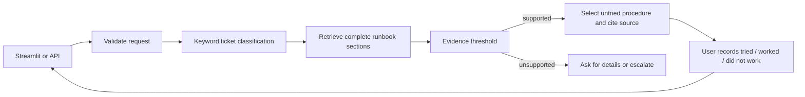

# GenAI IT Support Agent

A recruiter-facing IT troubleshooting demo, with an architecture that can later support an
internal helpdesk. The default flow is free: local semantic retrieval plus **verbatim runbook
sections**, with source references and session-only tracking of attempted procedures.

The assistant recommends guidance; it does not execute commands or change accounts. The five
runbooks are synthetic examples, not verified company policy. Review guidance before applying it.

## Run locally

Python 3.11 or 3.12 is the supported CI target.

```powershell
python -m venv .venv
.venv\Scripts\Activate.ps1
pip install -r requirements.txt
Copy-Item .env.example .env
uvicorn app.main:app --reload
```

In a second terminal with the environment active:

```powershell
streamlit run app/ui/streamlit_app.py
```

API: `http://localhost:8000/docs`. UI: `http://localhost:8501`.

Defaults: `LLM_PROVIDER=extractive`, `RETRIEVAL_MODE=semantic`, `RETRIEVAL_TOP_K=1`,
`RETRIEVAL_SCORE_THRESHOLD=0.7`. Semantic search downloads the free local embedding model
on its first use, then can run from cache. No LLM API key is needed. Set `RETRIEVAL_MODE=keyword`,
`RETRIEVAL_TOP_K=3`, and `RETRIEVAL_SCORE_THRESHOLD=0.55` for a model-free fallback; its measured
out-of-scope handling is weaker. `hybrid` is also available, with separately calibrated settings.

If an existing `.env` uses `LLM_PROVIDER=mock`, update it to `extractive` for useful runbook
answers. Mock mode is retained only as an explicitly labelled testing preview. Paid OpenAI
integration remains optional; it was not activated or exercised for this implementation.

## How it works



Runbook sections preserve prerequisites, numbered steps, code blocks and warnings. The free
answer path never fabricates commands or policies. It selects one complete procedure at a time.
Outcomes apply to the current issue; use **New issue / clear session** to change topics.
Previously attempted procedures are skipped, user-reported success marks resolution, and
exhausted runbooks show escalation guidance. This does not independently verify a fix.

History (up to 10 messages), the original issue and attempt outcomes are sent by the client.
Nothing is persisted on the server. The optional `conversation_id` is metadata only.
There is no authentication or manager-access system in this demo.

## Project layout

| Path | Purpose |
|---|---|
| `app/rag/local_support.py` | Section retrieval, keyword/semantic/hybrid scores, next procedure selection |
| `app/rag/generator.py` | Free extractive provider, mock preview, optional paid provider |
| `app/workflow` | LangGraph validation, classification, evidence gate and response routing |
| `app/api` | FastAPI schemas, health and support endpoints |
| `app/ui` | Streamlit chat, outcome controls and session reset |
| `app/ingestion` | Optional chunked ChromaDB ingestion and snapshot synchronization |
| `data/sample_docs` | Five synthetic IT troubleshooting runbooks |
| `data/eval` | Draft 60-case benchmark, reports and blank human study forms |
| `scripts/benchmark.py` | Local calibration and held-out comparison |
| `tests` | Components, ASGI endpoints, compiled workflows, persistent retrieval and headless UI |
| `skills-main` | Separate local Codex skills collection; not used as application knowledge |

## Evaluation and tests

```powershell
python -m pytest
python scripts/benchmark.py
```

The benchmark uses only cached local model files. If the model is unavailable, the report
records unavailable modes rather than substituting mock embeddings. To run only the keyword
baseline: `python scripts/benchmark.py --modes keyword`.

The current draft development benchmark contains 32 calibration and 28 held-out cases. The
semantic configuration retrieved an expected source for 25/25 answerable held-out cases,
abstained on 3/3 uncovered cases, and chose the labelled next section in 19/20 targeted cases.
All emitted steps were mechanically traceable to the runbooks. These small, runbook-derived
labels need independent human review; they do not establish production accuracy. Faster
resolution has **not** been measured. See `docs/EVALUATION.md` and the complete reports.

Use `docs/DEMO.md` for the recruiter walkthrough. The timed study and human-review CSVs are
blank intentionally. No paid evaluation or fabricated timing result is included.

## Optional legacy vector-store flow

```powershell
python scripts/ingest.py
```

Set `RETRIEVAL_MODE=vectorstore` to use the existing chunked ChromaDB retriever, typically
with mock or optional generative answers. The free section workflow uses Markdown runbooks
directly and does not require ingestion. The ingestion collection represents one nonempty
directory snapshot; stale chunks are removed after successful upserts. It is not transactional.

## Limits and next steps

- Section ranking and source runbook accuracy need independent review and broader evaluation.
- Plain text can be ingested by the legacy path; free section guidance requires `##` headings.
- Only five runbooks and a small draft dataset exist; partially covered requests require user judgment.
- Session history is untrusted input. Prompt-based paid generation is not a formal injection defense.
- No persistent conversations, authentication, supervisor access, automated remediation or cloud deployment.
- Paid model integration and further infrastructure require separate decisions.

MIT license. See `docs/SECURITY.md` for data handling and limitations.

Each free procedure includes a source-backed **Before you start** checklist. The checks are advisory and do not block the procedure. When requirements are undocumented, the app says so. Device readiness and successful resolution are not automatically verified.

Numbered runbooks now start at Step 1 and advance in source order. Error-specific alternatives remain matched to the reported error. Historical next-section benchmark figures describe the earlier direct-section policy, not this sequential workflow.

## Your rulebooks and internet fallback

Use **Add rulebooks** in the sidebar (or **Or paste a rulebook**) to add up to three UTF-8 `.md` or `.txt` files
(100 KB each; 200 KB combined). Use `##` headings and numbered steps. Uploaded files replace
the sample knowledge base for the current session, are embedded locally per request, and are
not saved to the server filesystem or sent to internet sources. Changing the selected files
clears the current troubleshooting history to avoid mixing procedures from different books.

The UI enables **Internet fallback** by default; it can be turned off. API clients opt in with
`internet_fallback: true`. If local evidence is absent, the app queries Microsoft Learn's public
search endpoint, fetches up to three official documentation pages, rejects untrusted URLs and
redirects, extracts complete procedures, then scores them locally. Matching local policies
are not overridden by internet advice, even if they contain no numbered procedure. Retrieval
failures also do not trigger a policy-bypassing fallback.

**Source checks** explains the path taken; external references include clickable URLs and UTC
fetch times. This is a heuristic source/relevance check, not independent proof that a resolution
is correct for your environment. If no suitable procedure survives the checks, the app requests
more detail or escalation. Public guidance must not override company policy.

Only search text is sent to Microsoft; the app removes common email, URL, IP and credential
patterns first. This redaction is incomplete: avoid confidential search text or disable fallback.
The free integration currently searches Microsoft Learn documentation, not the entire internet.
Its public search endpoint has no service guarantee here; failures produce no invented answer.
No paid API or LLM judge is used. PDF/DOCX uploads and permanent libraries are not implemented.
